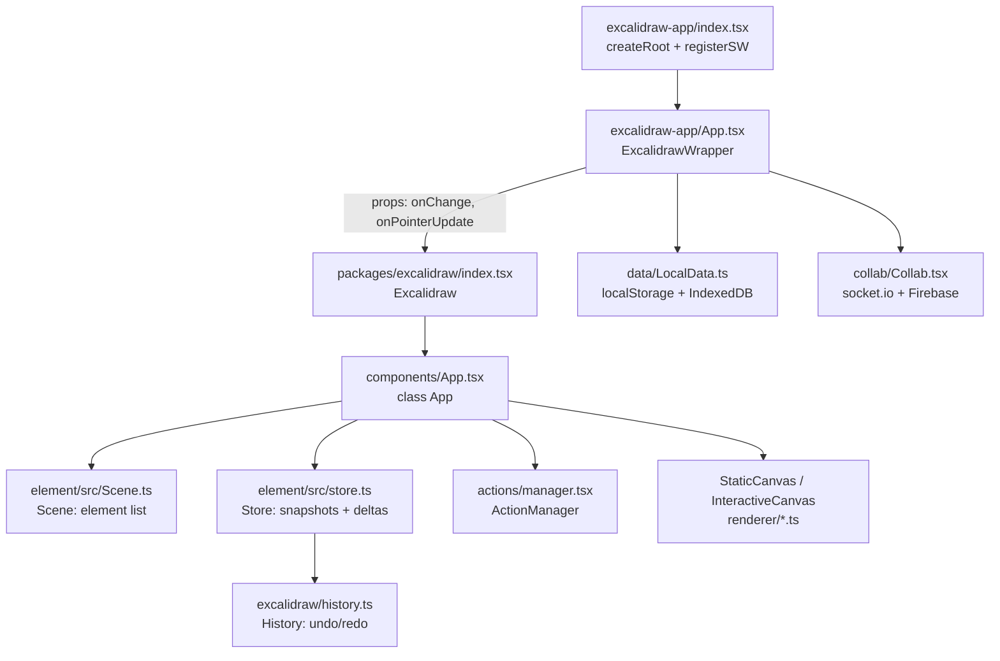
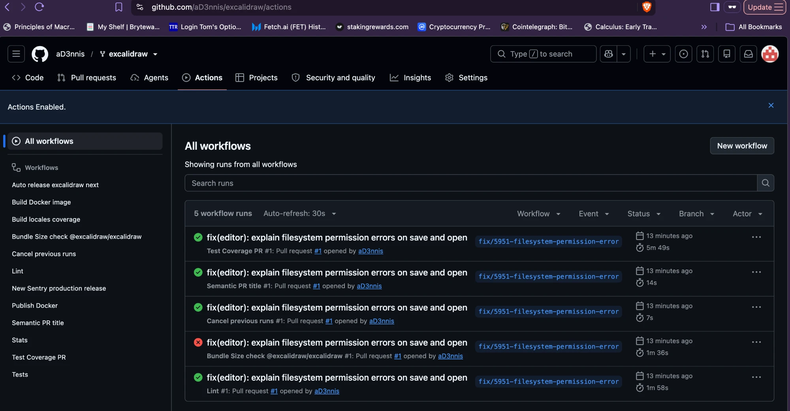

# Excalidraw: architecture map

Written for Project 1 (read an unfamiliar codebase with Claude Code). Base commit: `701b901a0` (upstream `master`, 2026-11-05). Every claim cites `path:line` at that commit; line numbers drift as upstream moves. Status: **draft, waiting for the claim check.**

## 1. What it is, in one paragraph

A Yarn-workspaces monorepo (`package.json`: `workspaces` = `excalidraw-app`, `packages/*`, `examples/*`). The editor is a React component library published as `@excalidraw/excalidraw` (`packages/excalidraw/package.json:2`). The website excalidraw.com is a separate Vite app, `excalidraw-app/`, that wraps that component and adds what a hosted product needs: local persistence, shareable links, live collaboration (`CLAUDE.md`, "Project Structure"). Packages are built with esbuild (`scripts/buildPackage.js:5`); the app is built with Vite (`excalidraw-app/vite.config.mts:2`).

## 2. Layout

| Folder | Role | Evidence |
| --- | --- | --- |
| `packages/common` | Constants, utilities, shared types | `tsconfig.json:22` (path alias) |
| `packages/math` | Points, vectors, geometry | `vitest.config.mts` aliases |
| `packages/element` | The element model: create, mutate, bind, resize, z-index, and the `Scene` and `Store` classes | `packages/element/src/Scene.ts:108`, `packages/element/src/store.ts:78` |
| `packages/excalidraw` | The editor component: `App` class, actions, renderer, data import/export, history, i18n | `packages/excalidraw/components/App.tsx:588` |
| `packages/utils`, `fractional-indexing`, `laser-pointer` | Export helpers, element ordering keys, laser trail | `vitest.config.mts` aliases |
| `excalidraw-app` | The excalidraw.com site: entry, persistence, collab, share | `excalidraw-app/index.tsx`, `excalidraw-app/App.tsx` |
| `examples/` | Integration examples (Next.js, browser script) | `CLAUDE.md`, "Project Structure" |

Inside the monorepo, `@excalidraw/*` imports resolve to source, not to built `dist/`: TypeScript through `tsconfig.json:22-26`, Vitest through the alias list in `vitest.config.mts`. So a change in `packages/element` is seen by the app and the tests without a package build.

## 3. Runtime architecture

- **Entry.** `excalidraw-app/index.tsx` creates the React root, registers the service worker (`registerSW()`), and renders `<ExcalidrawApp />` in `StrictMode`.
- **App shell.** `ExcalidrawWrapper` (`excalidraw-app/App.tsx:375`) renders `<Excalidraw onChange={onChange} onPointerUpdate={collabAPI?.onPointerUpdate} …>` (`excalidraw-app/App.tsx:956-963`) plus app-only UI (main menu, footer, share dialog, collab).
- **Library component.** `Excalidraw` is `React.memo(ExcalidrawBase)` (`packages/excalidraw/index.tsx:67`, `:403`); it wraps the editor in `<InitializeApp>` and renders `<App>` (`packages/excalidraw/index.tsx:210-211`).
- **Editor core.** `class App extends React.Component` (`packages/excalidraw/components/App.tsx:588`), 11,498 lines plus helper files split out as `App.*.ts` (`App.text.ts`, `App.pan.ts`, …). Its constructor builds the `ActionManager` (`:893`), the `Scene` (`:899`), the `Renderer` (`:903`), the `Store` (`:906`) and the `History` (`:907`), and registers undo and redo as actions (`:918-919`).
- **State split.** Elements live in the `Scene` (a mutable store outside React; `packages/element/src/Scene.ts:108-125`). UI state (tool, zoom, selection, dialogs) is React `AppState`, defaults in `packages/excalidraw/appState.ts`. A Scene update calls `triggerRender` (`App.tsx:3863`, `:5085`), not `setState` on the elements.
- **Rendering.** Three canvases: `<StaticCanvas>` for committed elements, `<NewElementCanvas>` for the element being drawn, `<InteractiveCanvas>` for selection handles and cursors (`App.tsx:2623`, `:2664`, `:2697`). Static drawing is in `renderer/staticScene.ts` (`renderStaticScene`, `:660`), throttled to animation frames (`:647`).

## 4. Data flow

### 4.1 A user edit (keyboard shortcut example)

1. Key press reaches `App.onKeyDown` (`App.tsx:5139`), which asks `actionManager.handleKeyDown(event)` (`App.tsx:5313`).
2. `ActionManager.handleKeyDown` finds the action whose `keyTest` matches (`actions/manager.tsx:92-106`) and runs `action.perform(elements, appState, value, app)` (`:147`).
3. The result goes to `App.syncActionResult` (`App.tsx:3134`), which schedules the capture mode on the store (`store.scheduleAction(actionResult.captureUpdate)`, `:3139`) and applies the new elements and app state.
4. Element changes go through `mutateElement` / `newElementWith` (`packages/element/src/mutateElement.ts:40`, `:149`), which bump `version`, `versionNonce` and `updated` (`:177-179`). Those fields drive collaboration (4.4).

### 4.2 After every update: commit, history, onChange

- `componentDidUpdate` ends with `this.store.commit(elementsMap, this.state)` (`App.tsx:4502`).
- The `Store` diffs against its last snapshot. A _durable_ increment (an undoable change) fires `onDurableIncrementEmitter` (`packages/element/src/store.ts:243`), and `App` records its delta in `History` (`App.tsx:3852-3853`; `history.ts:124`).
- Whether a change is undoable is set by `CaptureUpdateAction`: `IMMEDIATELY` (normal edits), `NEVER` (remote updates, scene load), `EVENTUALLY` (multi-step async work) (`packages/element/src/store.ts:38-69`).
- Unless the scene is still loading, `App` then calls the host's `props.onChange(elements, appState, files)` (`App.tsx:4508-4510`). The comment there explains why: an `onChange` with empty elements during load would overwrite localStorage.

### 4.3 Persistence (excalidraw-app only)

- The app's `onChange` (`excalidraw-app/App.tsx:715`) calls `LocalData.save(...)` (`:727`).
- `LocalData._save` is debounced by `SAVE_TO_LOCAL_STORAGE_TIMEOUT` = 300 ms (`excalidraw-app/data/LocalData.ts:125-140`; `excalidraw-app/app_constants.ts:2`). Elements and app state go to `localStorage` (`LocalData.ts:90-95`); image files go to IndexedDB (`createStore("files-db", "files-store")`, `LocalData.ts:49`).
- A full localStorage raises a quota flag atom instead of throwing (`LocalData.ts:105-106`).

### 4.4 Startup and shared links

`initializeScene` (`excalidraw-app/App.tsx:217`) loads, in order:

1. Local data: `importFromLocalStorage()` then `restoreElements` / `restoreAppState` (`:233-248`).
2. If the URL is a shared scene (`?id=`, `#json=<id>,<key>`) or a collab room link, it asks before overwriting a non-empty local scene (`:252-260`) and, for `#json=`, fetches and restores the backend scene (`:261-282`).
3. `#url=<…>` fetches a scene file from a URL (`:304-327`).
4. A room link starts collaboration (`:329-332`).

### 4.5 Live collaboration

- When collaborating, `onChange` calls `collabAPI.syncElements(elements)` (`excalidraw-app/App.tsx:720-721`), which broadcasts over the socket and queues a throttled Firebase save (`excalidraw-app/collab/Collab.tsx:982-984`, `:1001`).
- Transport: `socket.io-client`, lazy-loaded, connecting to `VITE_APP_WS_SERVER_URL` (`Collab.tsx:530`, `:545`; dev value `http://localhost:3002`, `.env.development:10`).
- End-to-end encryption: payloads are AES-GCM encrypted in the browser before sending (`excalidraw-app/collab/Portal.tsx:93`; `packages/excalidraw/data/encryption.ts:17-19`, `:50`, `:68`) and decrypted on receipt (`Collab.tsx:475`). The room key travels in the URL hash, which browsers do not send to the server.
- Merging remote elements: `reconcileElements` (`packages/excalidraw/data/reconcile.ts:73`) discards a remote element when the local copy is being edited, resized or drawn right now, when the local `version` is higher, or on a version tie when the local `versionNonce` is lower or equal (`reconcile.ts:23-42`). Remote scenes are applied with `CaptureUpdateAction.NEVER`, so they never enter local undo (`store.ts:50-58`).

## 5. Test setup

- **Runner:** Vitest, config in `vitest.config.mts`: `environment: "jsdom"`, `globals: true`, `setupFiles: ["./setupTests.ts"]`, hooks run in parallel.
- **Coverage gate:** thresholds lines 60, branches 70, functions 63, statements 60 (`vitest.config.mts`, `coverage.thresholds`). `vitest --coverage` fails the run below these.
- **Browser fakes** (`setupTests.ts`): canvas via `vitest-canvas-mock` (`:4`), DOM matchers via `@testing-library/jest-dom` (`:5`), IndexedDB via `fake-indexeddb/auto` (`:47`), plus stubs for `matchMedia`, `FontFace`, `document.fonts` (`:51`, `:65`, `:88`) and a mocked font face loader (`:102-112`).
- **Test helpers:** `packages/excalidraw/tests/helpers/ui.ts` simulates input (`Keyboard` `:65`, `Pointer` `:182`, `UI` `:449`); `helpers/api.ts` builds elements and drives the editor directly (`API` `:73`); `tests/test-utils.ts` has render and assertion helpers.
- **Where tests live:** 149 test files: integration tests in `packages/excalidraw/tests/*.test.tsx` (render `<Excalidraw>` and drive it), unit tests next to the code (for example `packages/excalidraw/actions/*.test.tsx`, `packages/element/tests/`). 23 `.snap` files hold snapshot assertions, including render counts.
- **Scripts** (`package.json`): `test` = `test:app` = `vitest`; `test:typecheck` = `tsc`; `test:code` = eslint with `--max-warnings=0`; `test:other` = prettier `--list-different` on css/scss/json/md/html/yml; `test:coverage`; `test:update` updates snapshots; `fix` runs prettier then eslint with `--fix`.
- **Pre-commit hook:** husky is installed, but `.husky/pre-commit` has `yarn lint-staged` commented out, so commits run no local checks.

## 6. CI: what runs, when, what blocks a merge

| Workflow | Trigger | Runs | Evidence |
| --- | --- | --- | --- |
| Tests | `push` to `master` only | `yarn install`, `yarn test:app` on Node 20 | `.github/workflows/test.yml` |
| Lint | every `pull_request` | `yarn test:other`, `yarn test:code`, `yarn test:typecheck` | `.github/workflows/lint.yml` |
| Test Coverage PR | every `pull_request` | `yarn test:coverage`, then posts a coverage report | `.github/workflows/test-coverage-pr.yml` |
| Semantic PR title | `pull_request` opened/edited/synchronize/labeled | title must be `type(scope): …`; types feat/fix/docs/…; **scope required**: app, editor, packages/excalidraw, packages/utils, docker, repo | `.github/workflows/semantic-pr-title.yml` |
| Bundle size | `pull_request` to `master` | size-limit on `packages/excalidraw` `build:esm` | `.github/workflows/size-limit.yml` |
| Cancel previous runs | `pull_request`, push to `release` | cancels superseded runs | `.github/workflows/cancel.yml` |
| Release, Docker, Sentry, locales | push to `release` / `l10n_master` | publishing | `autorelease-excalidraw.yml`, `build-docker.yml`, `publish-docker.yml`, `sentry-production.yml`, `locales-coverage.yml` |

**What blocks a merge upstream:** branch protection on `master` requires the checks `lint`, `semantic`, `coverage` and `Vercel – excalidraw`, enforced for non-admins (GitHub API `repos/excalidraw/excalidraw/branches/master`, read 2026-11-09). The full test suite runs on PRs inside the `coverage` job (`yarn test:coverage`), so a failing test blocks a merge there; `test.yml` re-runs it after the merge.

**On my fork:** a push to a feature branch triggers none of these, because `test.yml` listens only to `master` pushes. CI runs when a PR is opened inside the fork (branch → fork `master`): `lint`, `coverage`, `semantic`, size-limit and cancel. Vercel is a GitHub App on upstream only and won't run. The PR title must pass the semantic check, for example `fix(editor): …`.

**Bundle Size check disabled on my fork (2026-11-09).** On [PR #1](https://github.com/aD3nnis/excalidraw/pull/1), the first CI run (commit `a78fe99`) showed four checks green and _Bundle Size check @excalidraw/excalidraw_ red:

Why it failed, and why I disabled it rather than fixing it:

- **It measures nothing.** `packages/excalidraw/.size-limit.json` checks `dist/excalidraw.production.min.js` and `dist/excalidraw-assets/…`, but the package build now writes to `dist/dev/` and `dist/prod/` (`scripts/buildPackage.js:116`, `:122`). Every entry in the run log measured 0 bytes ([run 42704158914](https://github.com/aD3nnis/excalidraw/actions/runs/42704158914)).
- **It can't post on a fork.** The action failed to write its PR comment because the fork's workflow token is read-only ("Error creating comment … from a fork without write permissions").
- **Upstream stopped relying on it.** Its last three upstream runs (2026-09-04) failed, and it has not run since. It is not one of upstream's required checks (`lint`, `semantic`, `coverage`, Vercel).

Action: `gh workflow disable "Bundle Size check @excalidraw/excalidraw" -R aD3nnis/excalidraw` (fork only; upstream untouched). An empty commit (`dee48ca0c`) re-ran CI without it. Fixing the paths is an upstream task, out of scope for Project 1.

## 7. Local run results (2026-11-09, macOS, Node 22.22.3, yarn 1.22.22)

CI uses Node 20.x (`.github/workflows/*.yml`); `package.json` `engines` allows `>=18`.

| Command | Result | Time |
| --- | --- | --- |
| `yarn install --frozen-lockfile` | ✅ exit 0 (peer-dependency warnings only) | 45 s |
| `yarn test:typecheck` | ✅ exit 0 | 23 s |
| `yarn test:code` (eslint) | ✅ exit 0, 0 warnings | 49 s |
| `yarn test:other` (prettier) | ✅ exit 0 | 6 s |
| `yarn test:app --watch=false` | ⚠️ exit 1: 7 failed / 2,647 passed / 47 skipped (149 files) | 165 s |
| same 6 failing files re-run alone | ✅ 306 passed / 3 skipped | — |
| `yarn build` | ✅ exit 0, `excalidraw-app/build` = 38 MB | 34 s |

**The 7 failures are load-related flakes, not broken code.** They were 5-second test timeouts and one render-count snapshot mismatch (`history.test.tsx`), across `linearElementEditor`, `resize`, `history`, `renderOverrides`, `scrollConstraints` and `zindex`. All pass when their files run alone, and upstream's `Tests` workflow is green on this exact commit (`701b901a0`). Takeaway for the fix: run the touched test files alone first, then the full suite, and trust CI's Linux run as the arbiter.

## 8. Gotchas found while reading

- `App.tsx` is 11.5k lines; search by method name (`onKeyDown`, `syncActionResult`, `componentDidUpdate`) rather than scrolling.
- The repo ships its own agent instructions: `CLAUDE.md`, `AGENTS.md` (use `app.ownerDocument` / `app.ownerWindow` instead of globals; prefer `Merge<>` over `Omit<> &`), and `.github/copilot-instructions.md`.
- Upstream `CLAUDE.md` says "Always run `yarn test:update` before committing"; that rewrites snapshots, so review any `.snap` diff it produces.
